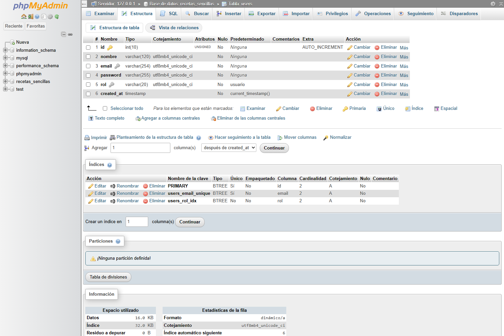
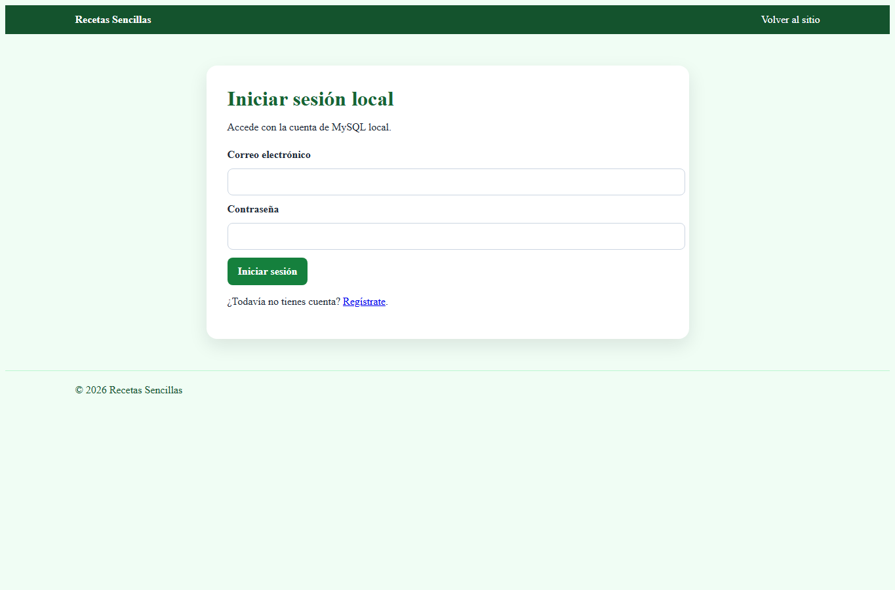
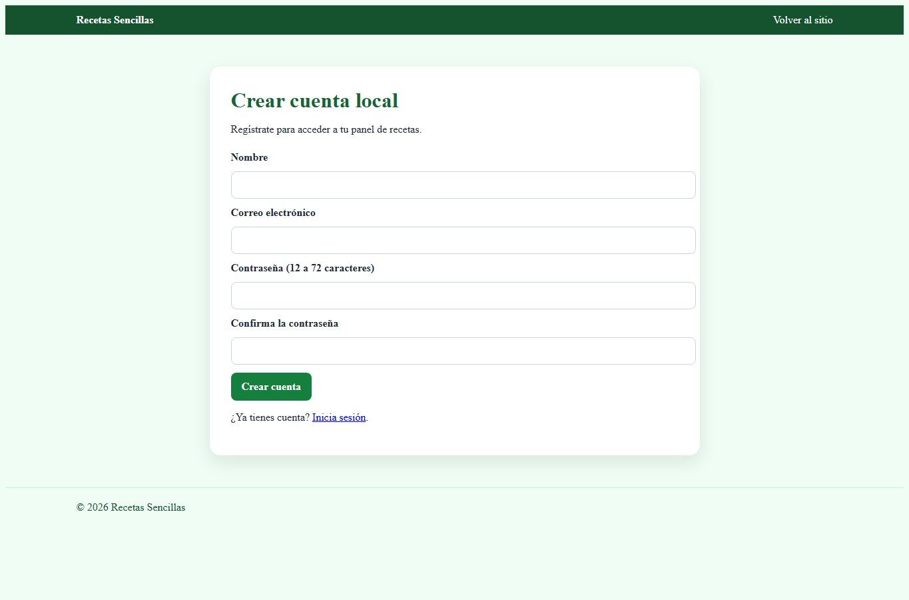
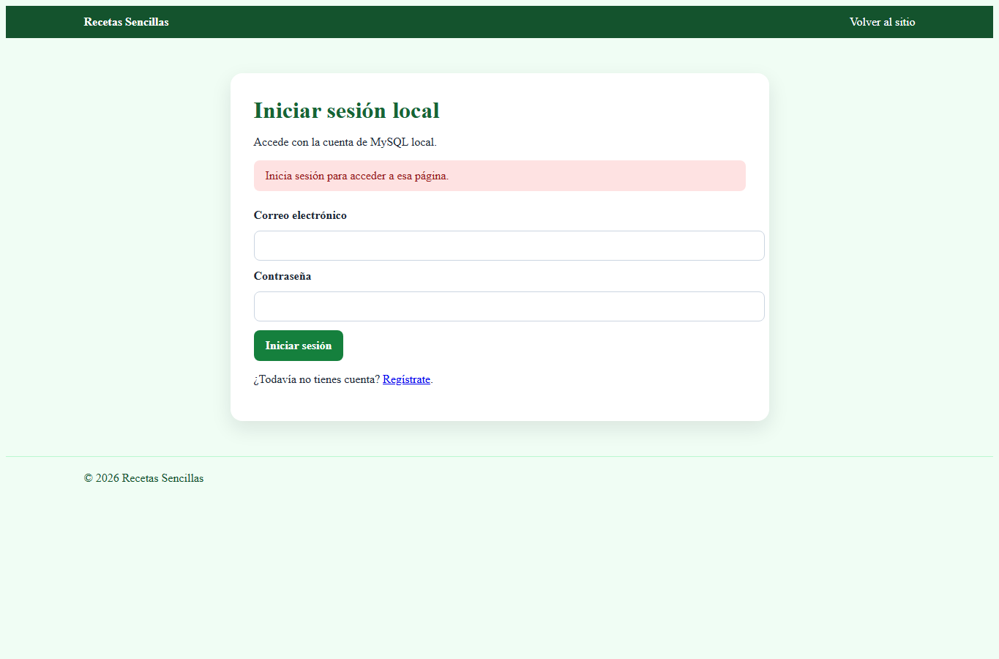

# Informe: autenticación local, sesiones y control de acceso

## Objetivo

Se implementó el registro, inicio y cierre de sesión de **Recetas Sencillas** con PHP y MySQL local. La aplicación mantiene la temática y las vistas del sitio, y el inicio de sesión local reemplaza la autenticación online. Las operaciones de autenticación no dependen de Supabase.

## Implementación de los requisitos

### 1. Persistencia de sesión y cookies seguras

El guardián reutilizable inicializa la sesión de PHP y configura el modo estricto, el uso exclusivo de cookies, `HttpOnly` y `SameSite=Lax`. La marca `Secure` se activa cuando la petición llega por HTTPS. Así, el navegador no expone la cookie a JavaScript y solo la envía en las condiciones configuradas.

Después de iniciar sesión o registrar una cuenta, se regenera el identificador con `session_regenerate_id(true)` para reducir el riesgo de fijación de sesión. En `$_SESSION` se conserva el identificador, nombre y rol del usuario. Al cerrar sesión, el servidor vacía los datos, caduca la cookie y destruye la sesión.

**Archivos:** [auth_guard.php](../includes/auth_guard.php), [login.php](../login.php), [registro.php](../registro.php), [logout.php](../logout.php).

### 2. Registro, login y logout con PHP y MySQL

- **Registro:** valida nombre, correo y contraseña; busca si el correo ya existe; inserta la nueva cuenta en MySQL y la inicia con rol `usuario`. No permite escoger el rol desde el formulario.
- **Inicio de sesión:** busca la cuenta por correo y verifica su contraseña contra el hash almacenado. Si las credenciales no son válidas, muestra un mensaje genérico.
- **Cierre de sesión:** solo acepta una solicitud POST protegida con token CSRF; elimina la sesión y redirige al formulario de acceso.
- **Conexión:** `conectar_mysql()` crea una instancia PDO con errores como excepciones, modo de consulta preparada nativa y codificación `utf8mb4`.

**Archivos:** [conexion.php](../includes/conexion.php), [registro.php](../registro.php), [login.php](../login.php), [logout.php](../logout.php), [auth.php](../api/auth.php).

### 3. Hashing de contraseñas

La contraseña se guarda con `password_hash($password, PASSWORD_BCRYPT)`; nunca se almacena como texto plano. Para autenticar se utiliza `password_verify()`. El formulario de registro exige una contraseña de 12 a 72 bytes; las cuentas de administración se provisionan por CLI, no desde el registro público. El proceso de alta administrativa obtiene sus datos de configuración y no contiene credenciales fijas en el código.

**Archivos:** [registro.php](../registro.php), [login.php](../login.php), [auth.php](../api/auth.php), [bootstrap_admin.php](../database/mysql/bootstrap_admin.php).

### 4. Protección de rutas y roles

`auth_require_login()` comprueba que exista una sesión y vuelve a consultar el rol vigente en MySQL. Si no hay sesión válida, redirige a `login.php?error=acceso_denegado`. `auth_require_role('admin')` devuelve una página de acceso denegado a las cuentas que no tengan ese rol.

El panel de usuario requiere autenticación. El panel de administración de usuarios y la gestión administrativa de recetas y blog requieren rol `admin`. Las cuentas registradas públicamente reciben siempre el rol `usuario`.

**Vistas protegidas:** [dashboard.php](../dashboard.php), [admin_panel.php](../admin_panel.php), [admin-local.php](../admin-local.php).

### 5. Tabla `users` en MySQL

El esquema define la tabla `users` con:

| Campo | Tipo / regla | Uso |
|---|---|---|
| `id` | `INT UNSIGNED`, clave primaria, autoincremental | Identificador de cuenta |
| `nombre` | `VARCHAR(120)`, obligatorio | Nombre que se muestra |
| `email` | `VARCHAR(254)`, único | Identificación de inicio de sesión |
| `password` | `VARCHAR(255)`, obligatorio | Hash bcrypt |
| `rol` | `VARCHAR(20)`, predeterminado `usuario` | Autorización |
| `created_at` | `TIMESTAMP`, predeterminado `CURRENT_TIMESTAMP` | Fecha de creación |

**Esquema:** [schema.sql](../database/mysql/schema.sql).

### Estructura real en phpMyAdmin

La captura muestra la tabla local `recetas_sencillas.users`, sus tipos de columna, la clave primaria autoincremental y el índice único de `email`. Se documenta la estructura, no los registros ni sus hashes.

### 6. Consultas preparadas y protección XSS

Las consultas de autenticación y cuentas preparan sus sentencias PDO y enlazan los valores con parámetros (`?`), incluidos los filtros, inserciones y actualizaciones pertinentes. Los datos dinámicos que se imprimen en las vistas se escapan con `htmlspecialchars()` a través del helper `auth_h()`, con comillas y codificación UTF-8. Los formularios y las mutaciones de la API también validan un token CSRF.

**Archivos:** [auth_guard.php](../includes/auth_guard.php), [auth.php](../api/auth.php), [admin_panel.php](../admin_panel.php).

## Evidencia visual local

Las siguientes capturas se tomaron de la aplicación local en `http://127.0.0.1:8000`. No contienen contraseñas, hashes ni tokens.

### Formulario de inicio de sesión

El formulario envía las credenciales a la autenticación local y no muestra ni solicita configuración de Supabase.

### Formulario de registro

Solicita nombre, correo y confirmación de contraseña; el rol se asigna en el servidor.

### Intento anónimo de acceder al panel administrativo

Al solicitar `admin_panel.php` sin una sesión válida, la aplicación bloquea el panel y presenta el aviso para iniciar sesión.

## Resultado

El flujo implementado es **registro → inicio de sesión → rutas protegidas según sesión y rol → cierre de sesión**. La identidad y los roles se mantienen en la sesión del servidor y las cuentas se almacenan en MySQL local. Las capturas documentan los formularios y el rechazo de un acceso anónimo; no exponen datos de autenticación.
